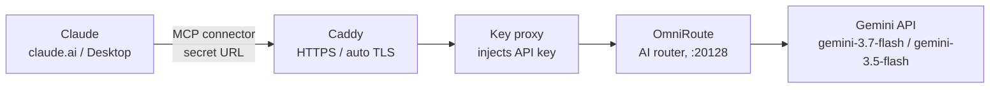

# claude-gemini-offload

> Let Claude delegate token-heavy work (code generation, long rewrites, boilerplate) to free/cheap **Gemini** models through a self-hosted **[OmniRoute](https://github.com/diegosouzapw/OmniRoute)** router — running for **$0** on an Oracle Cloud Always Free ARM VM.

## The problem

Claude is excellent at reasoning, planning and reviewing — but usage limits run out fast when it has to *write* thousands of lines of code or long documents. For independent developers, students and people with limited budgets, paying for higher tiers or API tokens is often not an option.

## The solution

Keep Claude as the **brain** (planning, architecture, review) and give it a tool to **offload the heavy typing** to Gemini Flash models (generous free tier). Claude sends a precise spec, Gemini generates, Claude reviews and integrates.

Result: the same output, a fraction of Claude's usage limits — on infrastructure that costs nothing.

**Verified end to end:** Claude produced a full 3D Earth animation (Three.js) by delegating the code generation to Gemini through this setup.

## Architecture



| Component | Role |
|---|---|
| **Claude** | Plans the task, writes a compact spec, reviews the result |
| **MCP connector** | Remote MCP server URL added in Claude (contains an unguessable secret path) |
| **Caddy** | Automatic HTTPS (Let's Encrypt), reverse proxy |
| **Key proxy** | Tiny local proxy that adds the OmniRoute API key so the key never lives in Claude |
| **OmniRoute** | Open-source AI router: providers, models, fallbacks, MCP endpoint |
| **Gemini** | Does the token-heavy generation |
| **Oracle Cloud Always Free** | Ubuntu 24.04, ARM Ampere, 2 OCPU / 12 GB RAM — free forever |

## Features

- 💸 **$0 hosting** on Oracle Cloud Always Free
- 🔒 HTTPS via Caddy, secret MCP path, API key kept server-side
- 🧠 Claude stays in control — Gemini only does the bulk work
- ⏱️ Timeouts raised to **600 s** for long generations
- 🔁 OmniRoute handles routing/fallbacks; add more providers later
- 🧩 Works with any MCP-capable client

## Setup (short version)

Full guide: [docs/setup-oracle.md](docs/setup-oracle.md)

1. **Create an Oracle Cloud Always Free VM** — Ubuntu 24.04, `VM.Standard.A1.Flex`, 2 OCPU / 12 GB. Open ports 80/443 in the security list.
2. **Run the installer** (or follow the manual steps):
   ```bash
   curl -fsSL https://raw.githubusercontent.com/mom1627/claude-gemini-offload/main/scripts/install.sh -o install.sh
   less install.sh   # always read scripts before running them
   sudo DOMAIN=<YOUR_DOMAIN> ADMIN_PASSWORD=<YOUR_ADMIN_PASSWORD> bash install.sh
   ```
3. **Add your Gemini API key** in the OmniRoute dashboard (get one free at Google AI Studio) and enable `gemini-3.7-flash` / `gemini-3.5-flash`.
4. **Create an OmniRoute API key** and put it in `/etc/key-proxy/.env` (see [examples/.env.example](examples/.env.example)).
5. **Connect Claude**: Settings → Connectors → Add custom connector →
   `https://<YOUR_DOMAIN>/<YOUR_SECRET_PATH>/api/mcp/stream`
6. Paste the delegation prompt from [CLAUDE_PROMPT.md](CLAUDE_PROMPT.md) into your project instructions.

Example configs: [Caddyfile](examples/Caddyfile) · [omniroute.service](examples/omniroute.service) · [key-proxy.service](examples/key-proxy.service)

## Token-saving tips for Claude

- Ask Claude to **plan first, then delegate**: spec → Gemini → review diff.
- Delegate anything > ~100 lines of output (full files, tests, docs, translations, data).
- Have Claude send **specs, not context dumps** — only the interfaces Gemini needs.
- Ask Gemini to return **only code**, no explanations.
- Let Claude **review and patch** small parts itself instead of regenerating.

See [CLAUDE_PROMPT.md](CLAUDE_PROMPT.md) for a ready-to-use prompt.

## Roadmap

See [ROADMAP.md](ROADMAP.md): one-click installer, cost/usage dashboard, more providers, docs in German and Arabic, community templates.

## Security

- Never commit real domains, IPs, keys or the secret MCP path.
- Treat the MCP URL like a password — anyone with it can use your quota.
- Rotate the OmniRoute API key if it leaks.

## License

[MIT](LICENSE) © 2026 **Mohamad Hannoura** — independent developer, Berlin.

*Goal: make powerful AI affordable and accessible for people with limited budgets.*
